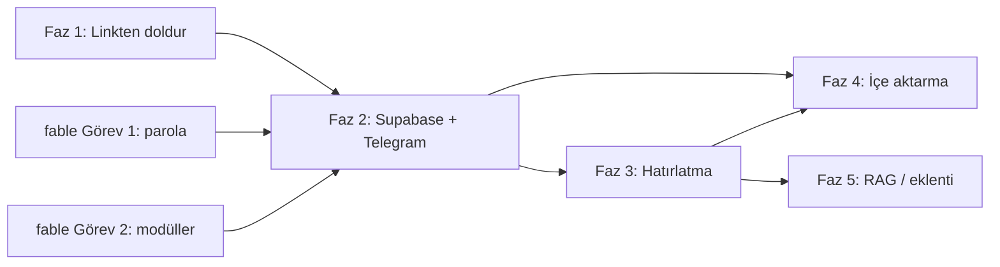

# 🌐 Semantic Galaxy — Etkileşim Planı

> **Hedef**: Uygulamayı "masaüstünde elle form doldurulan arşiv"den, **telefonda gördüğün an paylaştığın,
> başlığı/görseli kendiliğinden gelen ve unuttuğunda sana geri hatırlatan** bir sisteme çevirmek.
>
> **Format**: `fable.md` ile aynı. Her görev kendi kendine yeter, kararlar verilmiştir; daha ucuz bir model
> veya proje sahibi bu dosyayı tek başına uygulayabilir. Kararları (K1-K8) executor tartışmaz.
>
> **Tarih**: 2026-09-14 · **Temel commit**: `50566d4` · **Hazırlayan**: Claude (Opus 5)
> **İlişki**: Teknik borç görevleri `fable.md`'dedir. İkisi çelişirse **bu dosyadaki K-kararları geçerlidir**
> (fable.md'de ilgili görevlere not düşüldü).

---

## 0. Test Edilmiş Gerçekler

Bu plan tahmine değil, 2026-09-14'te bu makineden yapılan gerçek isteklere dayanır:

| Platform | Yöntem | Sonuç | Ne geliyor |
|---|---|---|---|
| YouTube | oEmbed (anahtarsız) + sayfa OpenGraph | ✅ 200 | başlık, kanal, küçük resim; açıklama OG'den |
| X / Twitter | `publish.twitter.com/oembed` (yönlendirme takip edilmeli, yoksa 301) | ✅ 200 | yazar + tweet metni (HTML içinden) + hashtag'ler |
| TikTok | oEmbed (anahtarsız) | ✅ 200 | caption, yazar, küçük resim, hashtag'ler |
| Spotify | oEmbed + OpenGraph | ✅ 200 | parça adı, "sanatçı · albüm · yıl", kapak |
| GitHub | REST API (anahtarsız, saatte 60 istek) | ✅ 200 | açıklama + **topics → hazır etiket** |
| Reddit | `.json` uç noktası | ❌ 403 (bot engeli) | — |
| Reddit | oEmbed | ✅ 200 | sadece başlık; subreddit URL'den etiket |
| Instagram | Resmî oEmbed | ❌ Meta uygulama token'ı ister | — |
| Instagram | Herkese açık sayfa OpenGraph | ⚠️ profil sayfasında ✅; gönderi/reel'de giriş duvarı çıkabilir | best-effort |
| Genel web | OpenGraph meta | ✅ (ör. elevenlabs.io, gemini.google.com) | başlık, açıklama, görsel |
| HuggingFace | model dosyası uç noktası | ✅ 200 | önceki SSL hatası **geçiciydi** |

**Kod doğrulaması**: Ek A (`src/enrich.py`) 12 gerçek URL'de çalıştırıldı → 11 başarılı (0,6-2,6 sn), 1 kasıtlı
geçersiz (`#`) doğru reddedildi. Ek A, C, E, G'nin testleri (Ek B, C-test, E-test, G-test) **14/14 geçti**.
Ek D ve F (Telegram botu) sözdizimi derlendi ama Telegram/Supabase hesabı olmadan **canlı test edilmedi**;
kabul kriterleriyle doğrulanmalı. Görev içindeki kısa kod parçaları (Streamlit entegrasyonu, script'ler)
test edilmedi; kabul kriterleri bunun için var.

**Test sırasında bulunan 2 mevcut hata** (fable.md'ye işlendi):
- `clean_tags("ai, , ses")` → `", ai, ses"` döndürüyor (boş parça filtrelenmiyor).
- Streamlit 1.30'da `.streamlit/secrets.toml` yokken `st.secrets.get(...)` **FileNotFoundError** fırlatıyor.
  fable.md Görev 1'deki parola kodu lokalde çökerdi; düzeltildi.

---

## 1. Mimari Kararlar

**K1 — Gelen Kutusu (inbox) deseni.** Her yakalama kanalı (Streamlit formu, Telegram botu, içe aktarma
script'leri) önce ham kayıt yazar: `link + kullanıcı notu + kanal`, `durum='bekliyor'`. Zenginleştirme
(`src/inbox.py`) ayrı adımdır. Hata olursa kayıt kaybolmaz, `durum='hata'` olur ve not ile kurtarılır.
*Neden*: Yeni kanal eklemek = tek INSERT. Kanallar birbirini bilmez, hiçbir paylaşım kaybolmaz.

**K2 — Zenginleştirme hafif, embedding ağır: ayrı yerlerde çalışır.** Link bilgisi çekmek sadece
`requests` ister → Telegram botu bunu **paylaştığın anda** yapar ve `📥 #12 <başlık>` diye cevap verir.
470MB'lık embedding modeli yalnızca Streamlit uygulamasında çalışır (mevcut cache'li hesaplama).
*Neden*: Bot ev bilgisayarında bile çalışabilir; kullanıcı doğru kaydedildiğini anında görür.

**K3 — FastAPI ön şart DEĞİL.** Eski plan (FUTURISTIC_UPDATES_2025.md 7.3) Telegram botu için "önce FastAPI"
diyordu. Gerçek ön şart **paylaşılan kalıcı veritabanıdır**: bot ile Streamlit farklı süreçlerde/makinelerde
çalışır, `data.csv` paylaşılamaz. Bot doğrudan veritabanına yazar. FastAPI yalnızca Chrome eklentisi için
gerekir (tarayıcıya veritabanı anahtarı konamayacağı için) → Faz 5.

**K4 — Paylaşılan veritabanı: Supabase (Postgres).**
*Neden*: (1) Streamlit Cloud + bot farklı makinelerde → sunucu tabanlı DB şart; (2) ucuz modeller
Postgres/`supabase-py`'yi alternatiflerden çok daha iyi bilir → uygulama hatası azalır; (3) web panelinden
veriye bakılabilir; (4) CV'de tanınan teknoloji.
*Revize edilen karar*: fable.md'deki "Postgres/Supabase'e geçilmeyecek" kararı tek süreçli kullanım
varsayımına dayanıyordu; Faz 2 bu varsayımı bozar. **Faz 2 yapılacaksa fable.md Görev 4 (yerel SQLite) atlanır.**
*Risk*: ücretsiz katman koşulları değişebilir → P2.1'in ilk adımı proje sahibinin bunu kontrol etmesi.

**K5 — Herkese açık demo ≠ kişisel veri.** CV'deki Streamlit Cloud linki örnek `data.csv` ile çalışmaya devam
eder (`DATA_BACKEND` tanımsız = csv). Kişisel kullanım aynı repodan **ikinci bir Streamlit uygulamasıdır**:
`DATA_BACKEND="supabase"` + erişim sadece proje sahibine açık (private). Kişisel kayıtların herkese açık
demo linkinde görünmesi kabul edilemez.

**K6 — Resmî uç nokta → OpenGraph → sadece link. Oturum/çerez ASLA.** Kullanıcının Instagram/X/TikTok oturum
çerezi, `yt-dlp`, giriş duvarını aşan scraping kullanılmaz (hesap ban riski + bakım yükü; proje sahibinin açık
önceliği). Bilgisi çekilemeyen kayıt kullanıcı notuyla tamamlanır (Faz 3 "Bu neydi?" döngüsü).

**K7 — Önce hatırlatma, sonra sohbet (RAG).** Eski planda RAG en yüksek öncelikti. Ama projenin çıkış
problemi *kaydedip unutmak*; üstelik Instagram kayıtları neredeyse boş metinle gelir ve RAG boş açıklamalarla
işe yaramaz. Sıra: **yakalama → zenginleştirme → hatırlatma → RAG**.

**K8 — Kendi mobil uygulaması ve Chrome eklentisi yok (şimdilik).** Telefonun paylaş menüsü → Telegram ve
masaüstünde Telegram Desktop'a paylaşma, aynı işi sıfır maliyet ve sıfır mağaza süreciyle görür. Eklenti ancak
Telegram akışı pratikte yetersiz kalırsa (Faz 5).

---

## 2. Faz Haritası

| Faz | Kullanıcı ne kazanır | Altyapı değişikliği | Süre | Bağımlılık |
|---|---|---|---|---|
| **1. Linkten doldur** | Link yapıştır → başlık, açıklama, görsel, etiket kendiliğinden; kartlarda küçük resim | Yok (CSV kalır) | 4 saat | yok |
| **2. Mobil yakalama** | Telefonda "Paylaş → Telegram" ile saniyeler içinde kayıt | Supabase + Telegram botu | 6-7 saat | Faz 1, fable Görev 1-2 |
| **3. Hatırlatma** | Her akşam 3 eski kayıt; eksik olanlar için "Bu neydi?" | Yok | 2 saat | Faz 2 |
| **4. Toplu içe aktarma** | Instagram kaydedilenler + tarayıcı yer imleri | Yok | 2 saat | Faz 2 (Faz 3 önerilir) |
| **5. İleri** | RAG sohbet, galakside tıklama, eklenti | FastAPI (eklenti için) | — | Faz 1-3 |



**Faz 1 tek başına değerlidir**: Faz 2'ye hiç geçilmese bile uygulama belirgin şekilde daha kullanışlı olur.

**⚠️ Canlı demo uyarısı**: Streamlit Cloud, GitHub `master` dalına bağlı; `master`'a her push herkese açık demoyu
yeniden yayınlar. Tüm kod görevlerini `gelistirme` dalında yap, kabul kriteri + smoke test geçince `master`'a
birleştir, ardından demo linkini açıp çalıştığını kontrol et (CLAUDE.md "Canlıya çıkış").

---

## 3. Faz 1 — Linkten Otomatik Doldurma

### P1.1 `src/enrich.py` link bilgi çıkarıcıyı ekle
- **Neden**: Tüm kanalların (form, bot, içe aktarma) ortak motoru. Test edilmiş kod Ek A'da.
- **Bağımlılık**: yok
- **Adımlar**:
  1. `src/` klasörü yoksa oluştur, içine boş `__init__.py` koy.
  2. Ek A'daki kodu **değiştirmeden** `src/enrich.py` olarak kaydet.
  3. `tests/` klasörü yoksa oluştur. Ek B'yi `tests/test_enrich.py` olarak kaydet.
  4. `requirements.txt`'e `requests==2.32.5` ekle (venv'deki sürüm; zaten dolaylı kuruluydu, artık doğrudan
     kullanılıyor). **BeautifulSoup ekleme**: kod standart kütüphanedeki `html.parser`'ı kullanır.
- **Kabul kriteri**: Repo kökünde `venv/Scripts/python.exe -m pytest tests/test_enrich.py -v` yeşil
  (pytest yoksa `venv/Scripts/pip install pytest`). Ayrıca
  `venv/Scripts/python.exe -c "from src.enrich import enrich; print(enrich('https://github.com/huggingface/transformers'))"`
  başlık, açıklama, görsel ve etiket adayları içeren bir `LinkMeta` basmalı.
- **Süre**: 15 dk

---

### P1.2 Veri şemasına `Kaynak`, `Gorsel`, `EklenmeTarihi` kolonlarını ekle
- **Neden**: Görsel kartlar, kaynağa göre filtre/renk ve hatırlatma (tarih) için. Geriye dönük uyumlu:
  eski 4 kolonlu CSV'ler ve yedekler açılmaya devam etmeli.
- **Bağımlılık**: P1.1
- **Adımlar**:
  1. `app.py`'de `DATA_FILE = "data.csv"` satırının hemen altına ekle:
     ```python
     from src.enrich import canonical_url, detect_source, enrich

     COLUMNS = ["Baslik", "Link", "Aciklama", "Tags", "Kaynak", "Gorsel", "EklenmeTarihi"]
     ```
  2. `load_data()` fonksiyonunun son satırı `return pd.read_csv(DATA_FILE)`'ı şununla değiştir:
     ```python
     df = pd.read_csv(DATA_FILE)
     for col in COLUMNS:
         if col not in df.columns:
             df[col] = ""
     extra = ["Link", "Kaynak", "Gorsel", "EklenmeTarihi"]
     df[extra] = df[extra].fillna("").astype(str)
     df["Kaynak"] = [k or (detect_source(canonical_url(l)) if canonical_url(l) else "web")
                     for k, l in zip(df["Kaynak"], df["Link"])]
     return df[COLUMNS]
     ```
  3. **⚠️ VERİ KAYBI TUZAĞI #1**: "Kaydet" butonu şu an `new_data.to_csv(DATA_FILE, mode='a', header=False, index=False)`
     ile 4 kolon ekliyor; kolon sayısı değişince CSV bozulur. Bu satırı şununla değiştir:
     ```python
     all_rows = pd.concat([load_data(), new_data], ignore_index=True)
     all_rows[COLUMNS].to_csv(DATA_FILE, index=False)
     ```
     Kaydetmek için `df` değişkenini **kullanma**: `process_embeddings` ona `x, y, z`, arama da `Benzerlik` ekliyor.
     (`new_data`'nın 7 kolonlu hali P1.3'te.)
  4. **⚠️ VERİ KAYBI TUZAĞI #2**: "Veri Yönetimi" sekmesi editöre sadece
     `edit_data[['Sil', 'Baslik', 'Link', 'Aciklama', 'Tags']]` veriyor; kaydedince yeni kolonlar silinir.
     `st.data_editor(...)` çağrısını şununla değiştir:
     ```python
     edited_df = st.data_editor(
         edit_data[["Sil"] + COLUMNS],
         num_rows="dynamic", use_container_width=True, key="data_editor",
         column_config={
             "Sil": st.column_config.CheckboxColumn("Sil?", width="small"),
             "Gorsel": st.column_config.ImageColumn("Görsel", width="small"),
             "Kaynak": st.column_config.TextColumn("Kaynak", disabled=True),
             "EklenmeTarihi": st.column_config.TextColumn("Tarih", disabled=True),
         },
     )
     ```
     Aynı bloktaki `edited_df.to_csv(DATA_FILE, index=False)` → `edited_df[COLUMNS].to_csv(DATA_FILE, index=False)`.
     Yedekten yükleme bloğunda da `uploaded_df.to_csv(...)` öncesine eksik kolonları ekle:
     `for col in COLUMNS: uploaded_df[col] = uploaded_df.get(col, "")`.
  5. `data.csv`'yi elle düzenleme: `load_data` eksik kolonları tamamlar, ilk kayıtta dosya yeni şemayla yazılır.
- **Kabul kriteri**: (a) Uygulama mevcut 4 kolonlu `data.csv` ile hatasız açılır; (b) yeni kayıt ekleyince
  `data.csv` 7 kolonlu olur, eski kayıtlar durur; (c) Veri Yönetimi'nde bir açıklamayı düzenleyip kaydedince
  `Kaynak`/`Gorsel` silinmez; (d) eski 4 kolonlu bir yedek CSV yüklenebilir; (e) CLAUDE.md'deki smoke test 0 exception.
- **Süre**: 45 dk

---

### P1.3 Kenar çubuğuna "🔗 Linkten Doldur" ekle
- **Neden**: Fazın en yüksek etkili adımı: kullanıcı sadece link yapıştırır.
- **Bağımlılık**: P1.2
- **Adımlar**:
  1. Ekleme formunun yeni sırası: **Link → 🔗 Linkten Doldur → mesaj/önizleme → Başlık → Açıklama → ✨ Tag Öner → Etiketler → Kaydet**.
  2. **⚠️ STREAMLIT TUZAĞI**: Bir widget çizildikten sonra aynı çalıştırmada `st.session_state[o_widget_key]`
     değiştirilirse `StreamlitAPIException` alınır. Doğru yol `on_click` callback'idir (callback'ler widget'lar
     çizilmeden önce çalışır). `import dataclasses` dosya başına; `with st.sidebar:` bloğunun **üstüne** ekle:
     ```python
     @st.cache_data(ttl=86400, show_spinner=False)
     def cached_enrich(url):
         return dataclasses.asdict(enrich(url))  # cache_data için düz dict

     def fill_from_link():
         meta = cached_enrich(st.session_state.get("new_link_input", ""))
         st.session_state.link_meta = meta if meta["ok"] else None
         if not meta["ok"]:
             st.session_state.link_msg = ("warning", f"Bilgi çekilemedi ({meta['error']}). Elle doldurabilirsin.")
             return
         st.session_state.new_link_input = meta["url"]  # takip parametreleri temizlenmiş hali
         # Sadece BOŞ alanları doldur; kullanıcının yazdığını ezme
         if not st.session_state.get("new_title_input"):
             st.session_state.new_title_input = meta["title"]
         if not st.session_state.get("new_desc_input"):
             st.session_state.new_desc_input = meta["description"]
         if meta["tag_candidates"] and not st.session_state.get("new_tags_input"):
             st.session_state.new_tags_input = ", ".join(meta["tag_candidates"])
         st.session_state.link_msg = ("success", f"{meta['source']} kaynağından dolduruldu")
     ```
  3. Formdaki `new_title = ...`, `new_link = ...`, `new_desc = ...` üç satırını şununla değiştir:
     ```python
     st.text_input("Link", key="new_link_input", placeholder="YouTube, Instagram, X, TikTok, GitHub, site...")
     st.button("🔗 Linkten Doldur", on_click=fill_from_link, use_container_width=True)
     if st.session_state.get("link_msg"):
         kind, text = st.session_state.pop("link_msg")
         getattr(st, kind)(text)
     preview = st.session_state.get("link_meta")
     if preview and preview.get("image"):
         st.image(preview["image"], use_column_width=True)  # Streamlit 1.30 parametresi
     new_title = st.text_input("Başlık", key="new_title_input")
     new_desc = st.text_area("Açıklama", key="new_desc_input")
     new_link = st.session_state.get("new_link_input", "")
     ```
  4. "Kaydet" bloğunda `new_data = pd.DataFrame({...})` satırını şununla değiştir:
     ```python
     meta = st.session_state.get("link_meta") or {}
     link = canonical_url(new_link)
     new_data = pd.DataFrame([{
         "Baslik": new_title, "Link": link, "Aciklama": new_desc, "Tags": final_tags,
         "Kaynak": detect_source(link) if link else "web",
         "Gorsel": meta.get("image", "") if meta.get("url") == link else "",
         "EklenmeTarihi": pd.Timestamp.now().strftime("%Y-%m-%d"),
     }])
     ```
  5. Form sıfırlama bloğuna (`if st.session_state.get("data_saved", False):`) ekle: `st.session_state.link_meta = None`.
- **Kabul kriteri**: Link kutusuna `https://github.com/huggingface/transformers` → "Linkten Doldur" → başlık,
  açıklama ve etiketler dolar, görsel görünür. Açıklama önceden yazılmışsa değişmez. `#` yazınca uyarı çıkar,
  uygulama çökmez. `https://youtu.be/dQw4w9WgXcQ?si=abc` yazınca link kutusu `?si=abc`'siz hale gelir.
  Kaydet → `data.csv`'de 7 kolon dolu.
- **Süre**: 60 dk

---

### P1.4 Kartlarda küçük resim, kaynak filtresi, galakside kaynak rengi
- **Neden**: Görsel hafıza. İnsan bir reel'i başlığından değil küçük resminden hatırlar.
- **Bağımlılık**: P1.2. (fable.md Görev 6 yapılmadıysa aşağıdaki 4. adım onu da kapsar; Görev 6'yı ayrıca yapma.)
- **Adımlar**:
  1. `app.py` başına:
     ```python
     KAYNAK_IKON = {"youtube": "▶️", "x": "𝕏", "tiktok": "🎵", "instagram": "📸",
                    "github": "🐙", "spotify": "🎧", "reddit": "👽", "web": "🌐"}
     ```
  2. Kenar çubuğunda AND/OR checkbox'ının altına:
     ```python
     kaynaklar = sorted(df["Kaynak"].unique()) if not df.empty else []
     selected_sources = st.multiselect("Kaynak", kaynaklar,
                                       format_func=lambda k: f"{KAYNAK_IKON.get(k, '🔗')} {k}")
     ```
     "ANA FİLTRELEME" bölümünün sonuna:
     `if selected_sources: filtered_df = filtered_df[filtered_df["Kaynak"].isin(selected_sources)]`
  3. Liste sekmesinde `for index, row in results.iterrows():` döngüsünün gövdesini iki kolona böl:
     ```python
     col_img, col_txt = st.columns([1, 6])
     with col_img:
         if row["Gorsel"]:
             st.image(row["Gorsel"], use_column_width=True)
         else:
             st.markdown(f"## {KAYNAK_IKON.get(row['Kaynak'], '🔗')}")
     with col_txt:
         ...  # mevcut progress bar + st.info kodu buraya, girintisi artırılarak
     ```
     Instagram/TikTok görsel linkleri süreli olabilir; kırık görsel beklenen durumdur (P1.5 ile yenilenir).
  4. Galaksi sekmesinde `px.scatter_3d` çağrısından hemen önce:
     ```python
     renk = st.radio("Renk", ["Ana etiket", "Kaynak"], horizontal=True)
     plot_df = filtered_df.copy()
     plot_df["AnaEtiket"] = plot_df["Tags"].astype(str).str.split(",").str[0].str.strip()
     color_col = "AnaEtiket" if renk == "Ana etiket" else "Kaynak"
     ```
     `px.scatter_3d(filtered_df, ..., color='Tags', ...)` → `px.scatter_3d(plot_df, ..., color=color_col, ...)`;
     `hover_data` sözlüğüne `'Kaynak': True` ekle (`'Tags': True` kalsın).
- **Kabul kriteri**: Görseli olan kayıtlarda küçük resim, olmayanlarda kaynak ikonu görünür. "Kaynak" filtresi
  hem listeyi hem galaksiyi süzer. Galakside "Kaynak" seçilince legend'da kaynak adları, "Ana etiket" seçilince
  tekil etiketler görünür (kombinasyonlar değil).
- **Süre**: 45 dk

---

### P1.5 Mevcut kayıtları geriye dönük doldur
- **Neden**: Eski kayıtlarda görsel/kaynak yok; tek tuşla tamamlanmalı.
- **Bağımlılık**: P1.2
- **Adımlar**: `import time` dosya başına. "Veri Yönetimi" sekmesinde `st.header(...)` satırının altına:
  ```python
  if st.button("🔄 Eksik görsel/kaynak bilgisini linkten doldur"):
      raw = load_data()
      todo = raw[(raw["Gorsel"] == "") & raw["Link"].map(lambda l: bool(canonical_url(l)))].head(50)
      bar = st.progress(0.0)
      for i, (idx, row) in enumerate(todo.iterrows(), start=1):
          meta = enrich(row["Link"])
          if meta.ok:
              raw.at[idx, "Gorsel"] = meta.image
              raw.at[idx, "Kaynak"] = meta.source
              if not str(raw.at[idx, "Aciklama"]).strip():
                  raw.at[idx, "Aciklama"] = meta.description
          bar.progress(i / len(todo))
          time.sleep(0.5)  # sitelere nazik ol
      raw[COLUMNS].to_csv(DATA_FILE, index=False)
      process_embeddings.clear()
      st.success(f"{len(todo)} kayıt kontrol edildi.")
      st.rerun()
  ```
  Başlıklar ve dolu açıklamalar **asla** değiştirilmez. Tek tıkta en fazla 50 kayıt.
- **Kabul kriteri**: Butona basınca geçerli linkli kayıtlara görsel gelir (ör. ElevenLabs, Gemini, Deepseek);
  `#` linkli örnek kayıtlar atlanır; mevcut başlık/açıklamalar birebir aynı kalır.
- **Süre**: 30 dk

---

## 4. Faz 2 — Mobil Yakalama (Supabase + Telegram)

**Önkoşul**: fable.md Görev 1 (parola) ve Görev 2 (modülerleştirme: `clean_tags` artık `src/data.py`'de,
streamlit import etmeden) tamamlanmış olmalı.

### P2.1 Supabase projesi ve şema
- **Neden**: K3/K4. Bot ve Streamlit aynı kalıcı depoya yazmalı.
- **Bağımlılık**: Faz 1, fable Görev 1-2
- **Adımlar**:
  1. **🚦 Karar kapısı (proje sahibi)**: supabase.com ücretsiz katman koşullarını oku (hareketsiz projelerin
     duraklatılması, satır/depolama limitleri). Kabul edilemezse **DUR**; executor alternatif veritabanı SEÇMEZ.
  2. **Proje sahibi**: Supabase'de proje oluştur. Project Settings → API'den `Project URL` ve `service_role` anahtarını al.
  3. SQL Editor'da çalıştır:
     ```sql
     create table if not exists bookmarks (
       id bigint generated always as identity primary key,
       baslik text not null default '',
       link text not null default '',
       aciklama text not null default '',
       tags text not null default 'genel',
       kaynak text not null default 'web',
       gorsel text not null default '',
       kullanici_notu text not null default '',
       kanal text not null default 'streamlit'
         check (kanal in ('streamlit', 'telegram', 'import_csv', 'import_instagram', 'import_tarayici')),
       durum text not null default 'hazir'
         check (durum in ('bekliyor', 'hazir', 'hata', 'arsiv')),
       hata_mesaji text not null default '',
       gosterim_sayisi int not null default 0,
       son_gosterim timestamptz,
       created_at timestamptz not null default now()
     );
     -- Aynı link iki kez kaydedilemez (boş link hariç: linksiz notlar serbest)
     create unique index if not exists bookmarks_link_uniq on bookmarks (link) where link <> '';
     create index if not exists bookmarks_durum_idx on bookmarks (durum);
     -- Bilinçli olarak HİÇ policy yok: public/anon anahtarla hiçbir şey okunamaz/yazılamaz.
     -- Streamlit (sunucu tarafı) ve bot service_role anahtarı kullanır.
     alter table bookmarks enable row level security;
     ```
  4. Anahtarları repo'ya ASLA koyma. Lokalde:
     ```toml
     # .streamlit/secrets.toml  (zaten .gitignore'da)
     DATA_BACKEND = "supabase"
     SUPABASE_URL = "https://xxxx.supabase.co"
     SUPABASE_SERVICE_KEY = "..."
     admin_password = "..."
     ```
     ```ini
     # .env  (bot ve script'ler için)
     SUPABASE_URL=https://xxxx.supabase.co
     SUPABASE_SERVICE_KEY=...
     TELEGRAM_BOT_TOKEN=...
     ALLOWED_USER_ID=0
     ```
  5. `.gitignore`'a ekle: `.env` ve `bot/bot.log`.
  6. `requirements.txt`'e `supabase` ve `python-dotenv` ekle; kurduktan sonra `pip show supabase python-dotenv`
     ile sürümleri okuyup `==` ile sabitle.
- **Kabul kriteri**: Supabase Table Editor'da `bookmarks` tablosu görünür; `git status` çıktısında `.env` ve
  `secrets.toml` yoktur.
- **Süre**: 30 dk

---

### P2.2 `scripts/` ortak yardımcı + CSV → Supabase taşıma
- **Neden**: Mevcut kişisel kayıtlar veritabanına geçmeli. Demo `data.csv` repo'da kalır (K5).
- **Bağımlılık**: P2.1
- **Adımlar**:
  1. `scripts/__init__.py` (boş) ve `scripts/_common.py`:
     ```python
     import os

     from dotenv import load_dotenv
     from supabase import create_client


     def get_db():
         load_dotenv()
         return create_client(os.environ["SUPABASE_URL"], os.environ["SUPABASE_SERVICE_KEY"])


     def existing_links(db):
         links, start = set(), 0
         while True:  # Supabase istek başına en fazla 1000 satır döner
             batch = db.table("bookmarks").select("link").range(start, start + 999).execute().data
             links.update(r["link"] for r in batch)
             if len(batch) < 1000:
                 return links
             start += 1000


     def insert_new(db, rows, allow_empty_link=False):
         """Veritabanında ve kendi içinde tekrar eden linkleri atlayıp 100'erli ekler. Eklenen sayıyı döner."""
         seen, new = existing_links(db), []
         for r in rows:
             if not r["link"]:
                 if allow_empty_link:
                     new.append(r)
                 continue
             if r["link"] not in seen:
                 seen.add(r["link"])
                 new.append(r)
         for i in range(0, len(new), 100):
             db.table("bookmarks").insert(new[i:i + 100]).execute()
         return len(new)
     ```
  2. `scripts/migrate_csv.py`:
     ```python
     """data.csv -> Supabase. Kullanım (repo kökünden): python -m scripts.migrate_csv [--dry-run]"""
     import sys

     import pandas as pd

     from scripts._common import get_db, insert_new
     from src.data import clean_tags
     from src.enrich import canonical_url, detect_source

     df = pd.read_csv("data.csv").fillna("").astype(str)
     rows = []
     for _, r in df.iterrows():
         link = canonical_url(r["Link"])
         row = {"baslik": r["Baslik"], "link": link, "aciklama": r["Aciklama"], "tags": clean_tags(r["Tags"]),
                "kaynak": r.get("Kaynak") or (detect_source(link) if link else "web"),
                "gorsel": r.get("Gorsel", ""), "kanal": "import_csv", "durum": "hazir"}
         if r.get("EklenmeTarihi"):
             row["created_at"] = f"{r['EklenmeTarihi']}T12:00:00+00:00"
         rows.append(row)

     if "--dry-run" in sys.argv:
         print(*rows[:5], sep="\n")
         print(len(rows), "satır okunacak")
     else:
         added = insert_new(get_db(), rows, allow_empty_link=True)
         print(f"{added} kayıt eklendi, {len(rows) - added} zaten vardı.")
     ```
- **Kabul kriteri**: `python -m scripts.migrate_csv --dry-run` 5 satır basar. Gerçek çalıştırma sonrası
  Supabase'deki satır sayısı = CSV satır sayısı. ⚠️ İkinci kez çalıştırma linksiz satırları (`#` linkli örnekler)
  tekrar ekler; script **bir kez** çalıştırılır.
- **Süre**: 30 dk

---

### P2.3 `src/inbox.py`, `src/store.py` ve Streamlit entegrasyonu
- **Neden**: K1/K2 ortak zenginleştirme mantığı; Streamlit iki arka ucu (csv/supabase) desteklemeli (K5).
- **Bağımlılık**: P2.2
- **Adımlar**:
  1. Ek C'yi `src/inbox.py`, Ek C-test'i `tests/test_inbox.py` olarak kaydet.
  2. `src/store.py` oluştur. **Karar**: iki modda da yeni kayıt sadece kenar çubuğu formundan eklenir
     (editörde `num_rows="fixed"`); editördeki "Sil" iki modda da farklı çalışır: CSV'de satırı siler,
     Supabase'de `durum='arsiv'` yapar (geri alınabilir).
     ```python
     """Veri deposu. DATA_BACKEND tanımsız/csv = herkese açık demo; supabase = kişisel kullanım."""
     import os

     import pandas as pd

     from src.enrich import canonical_url, detect_source

     COLUMNS = ["Baslik", "Link", "Aciklama", "Tags", "Kaynak", "Gorsel", "EklenmeTarihi"]
     APP_TO_DB = {"Baslik": "baslik", "Link": "link", "Aciklama": "aciklama", "Tags": "tags",
                  "Kaynak": "kaynak", "Gorsel": "gorsel"}


     class CsvStore:
         def __init__(self, path):
             self.path = path

         def load(self):
             # app.py'deki load_data() gövdesini (örnek veri oluşturma + P1.2 kolon tamamlama) buraya TAŞI.
             # Dönüş: COLUMNS kolonlu DataFrame, index = satır numarası.
             ...

         def add(self, record):
             pd.concat([self.load(), pd.DataFrame([record])], ignore_index=True)[COLUMNS].to_csv(self.path, index=False)

         def apply_edits(self, changes, archive_ids):
             df = self.load()
             for row_id, fields in changes.items():
                 for col, value in fields.items():
                     df.at[row_id, col] = value
             df.drop(index=list(archive_ids))[COLUMNS].to_csv(self.path, index=False)


     class SupabaseStore:
         def __init__(self, client):
             self.db = client

         def load(self):
             rows, start = [], 0
             cols = "id,created_at," + ",".join(APP_TO_DB.values())
             while True:
                 batch = (self.db.table("bookmarks").select(cols).eq("durum", "hazir")
                          .order("id").range(start, start + 999).execute().data)
                 rows += batch
                 if len(batch) < 1000:
                     break
                 start += 1000
             df = pd.DataFrame(rows, columns=["id", "created_at", *APP_TO_DB.values()])
             df = df.rename(columns={v: k for k, v in APP_TO_DB.items()})
             df["EklenmeTarihi"] = df.pop("created_at").astype(str).str[:10]
             return df.set_index("id")[COLUMNS]

         def add(self, record):
             data = {APP_TO_DB[k]: v for k, v in record.items() if k in APP_TO_DB}
             self.db.table("bookmarks").insert({**data, "kanal": "streamlit"}).execute()

         def apply_edits(self, changes, archive_ids):
             for row_id, fields in changes.items():
                 data = {APP_TO_DB[k]: v for k, v in fields.items() if k in APP_TO_DB}
                 self.db.table("bookmarks").update(data).eq("id", int(row_id)).execute()
             if archive_ids:
                 self.db.table("bookmarks").update({"durum": "arsiv"}).in_("id", [int(i) for i in archive_ids]).execute()

         def pending_count(self):
             return len(self.db.table("bookmarks").select("id").eq("durum", "bekliyor").limit(1000).execute().data)

         def failed(self):
             return (self.db.table("bookmarks").select("id,link,hata_mesaji,kullanici_notu")
                     .eq("durum", "hata").order("created_at", desc=True).limit(50).execute().data)

         def resolve_failed(self, row_id, baslik, aciklama):
             self.db.table("bookmarks").update(
                 {"baslik": baslik, "aciklama": aciklama, "durum": "hazir", "hata_mesaji": ""}
             ).eq("id", int(row_id)).execute()
     ```
  3. `app.py` bağlantısı (mevcut `load_data` ve `DATA_FILE` tanımlarının yerine):
     ```python
     from src.inbox import process_pending
     from src.store import COLUMNS, CsvStore, SupabaseStore

     def secret(key, default=""):
         # Streamlit 1.30: secrets.toml yokken st.secrets erişimi FileNotFoundError fırlatır
         try:
             return st.secrets.get(key, default)
         except FileNotFoundError:
             return default

     @st.cache_resource
     def get_store():
         if secret("DATA_BACKEND", "csv") == "supabase":
             from supabase import create_client
             return SupabaseStore(create_client(secret("SUPABASE_URL"), secret("SUPABASE_SERVICE_KEY")))
         return CsvStore("data.csv")

     @st.cache_data(ttl=60, show_spinner=False)
     def load_data():
         return get_store().load()

     def after_write():
         load_data.clear()
         process_embeddings.clear()
         st.rerun()
     ```
     - "Kaydet": `get_store().add({... 7 kolon, P1.3'teki sözlük ...})` → `after_write()`.
     - Veri Yönetimi editörü: `num_rows="fixed"`; mevcut `edited_df = edited_df.reset_index(drop=True)` satırını
       **SİL** (index = kayıt kimliği, sıfırlanırsa yanlış kayıt güncellenir). Kaydederken:
       ```python
       archive_ids = edited_df.index[edited_df["Sil"]].tolist()
       changes = {}
       for rid, row in edited_df[~edited_df["Sil"]].iterrows():
           diff = {c: row[c] for c in ["Baslik", "Link", "Aciklama", "Tags"] if row[c] != df.at[rid, c]}
           if "Tags" in diff:
               diff["Tags"] = clean_tags(diff["Tags"])
           if diff:
               changes[rid] = diff
       get_store().apply_edits(changes, archive_ids)
       after_write()
       ```
       (Mevcut boş başlık/açıklama doğrulaması `apply_edits`'ten önce kalır.)
     - Kenar çubuğu, sadece Supabase modunda (`isinstance(get_store(), SupabaseStore)`):
       ```python
       bekleyen = get_store().pending_count()
       if bekleyen and st.button(f"📥 Gelen kutusunu işle ({bekleyen})"):
           with st.spinner("Linkler okunuyor..."):
               process_pending(get_store().db, limit=50)
           after_write()
       ```
     - Veri Yönetimi'nde, sadece Supabase modunda `st.expander("⚠️ İşlenemeyen kayıtlar")`: `get_store().failed()`
       listesindeki her kayıt için link + hata mesajı + başlık/açıklama kutuları + "Kaydet" butonu →
       `resolve_failed(...)` → `after_write()`. Buton/kutu `key`'lerine kayıt id'sini ekle (`key=f"fix_title_{r['id']}"`).
- **Kabul kriteri**: (a) `secrets.toml` yokken uygulama CSV ile eskisi gibi çalışır (smoke test 0 exception);
  (b) `DATA_BACKEND="supabase"` ile Supabase kayıtları görünür; (c) formdan eklenen kayıt Supabase'e düşer;
  (d) editörde bir açıklamayı değiştirmek **sadece o satırı** günceller; (e) "Sil" kaydı `arsiv` yapar, Supabase'de satır durur;
  (f) `pytest tests/` yeşil.
- **Süre**: 2 saat (gerekirse "store + taşıma" ve "gelen kutusu UI" diye ikiye böl)

---

### P2.4 Telegram botu
- **Neden**: K8: telefonun paylaş menüsünden tek dokunuşla kayıt. K2: anında başlıkla onay.
- **Bağımlılık**: P2.3
- **Adımlar**:
  1. **Proje sahibi**: Telegram'da @BotFather → `/newbot` → token'ı `.env`'e `TELEGRAM_BOT_TOKEN` olarak yaz.
     BotFather'da `/setcommands`:
     ```
     son - Son 5 kayıt
     not - Bir kayda not ekle (ör. /not 12)
     hatirla - Hatırlatmayı şimdi gönder
     ```
  2. `bot/__init__.py` (boş) oluştur, Ek D'yi `bot/main.py` olarak kaydet.
  3. `bot/requirements.txt`:
     ```
     python-telegram-bot[job-queue]
     supabase
     python-dotenv
     requests==2.32.5
     pandas==2.1.4
     numpy==1.26.2
     tzdata
     ```
     `venv/Scripts/pip install -r bot/requirements.txt`, sonra sabitlenmemiş olanların sürümünü `pip show` ile okuyup
     `==` ile yaz. Bot **`sentence-transformers` kurmaz** (K2). `tzdata`: Windows'ta saat dilimi veritabanı yok, Faz 3 için şart.
  4. Repo kökünden çalıştır: `venv/Scripts/python.exe -m bot.main`. Telegram'da bota `/start` yaz → gelen ID'yi
     `.env`'de `ALLOWED_USER_ID`'ye yaz → botu durdurup yeniden başlat.
  5. Ek D'deki güvenlik davranışlarını **değiştirme**: sadece `ALLOWED_USER_ID`'nin mesajları işlenir; `httpx`
     logları WARNING'e çekilidir (INFO'da bot token'ı loglanır); linkler `canonical_url` ile temizlenir
     (Instagram `?igsh=`, YouTube `?si=`, X `?s=&t=` aynı içeriğin iki kez kaydedilmesine yol açmasın).
- **Kabul kriteri**: Telefonda YouTube/TikTok/Instagram'da bir içerik → Paylaş → Telegram → bot. Bot birkaç saniye
  içinde `📥 #id Başlık` + `🏷️ etiketler` cevaplar. Aynı içeriği tekrar paylaşınca `🔁 Zaten kayıtlı`. Bilgisi
  çekilemeyen bir linkte `/not <id>` sonrası yazılan cümle o kaydın açıklamasına eklenir. Başka bir Telegram
  hesabından yazınca bot hiç cevap vermez. Kişisel Streamlit uygulamasında kayıt en geç 60 sn sonra görünür.
- **Süre**: 1,5 saat

---

### P2.5 Botu sürekli çalıştır
- **Neden**: Paylaşımlar bot kapalıyken de kaybolmamalı.
- **Bağımlılık**: P2.4
- **Karar**: Bot önce **kendi bilgisayarında** çalışır (0 TL). Telegram, alınmamış güncellemeleri sunucuda
  24 saate kadar tutar; bilgisayar günde bir kez açılıyorsa paylaşım kaybolmaz. 7/24 sunucu ancak bu yetmezse
  düşünülür ve ücretli olacağı için o karar proje sahibinindir.
- **Adımlar**:
  1. `bot/run_bot.bat`:
     ```bat
     @echo off
     cd /d "%~dp0.."
     venv\Scripts\python.exe -m bot.main >> bot\bot.log 2>&1
     ```
  2. **Proje sahibi** (PowerShell): oturum açılışında başlat:
     ```powershell
     schtasks /create /tn "SemanticGalaxyBot" /tr "\"C:\Users\Administrator\Desktop\SematicGalaxyContext\bot\run_bot.bat\"" /sc onlogon
     ```
- **Kabul kriteri**: Bilgisayar yeniden başlayıp oturum açılınca bot kendiliğinden cevap verir, `bot\bot.log` oluşur.
  Bot kapalıyken paylaşılan link, bot açıldıktan sonra işlenir.
- **Süre**: 20 dk

---

## 5. Faz 3 — Hatırlatma Döngüsü (projenin asıl amacı)

### P3.1 `src/recall.py` seçim fonksiyonu
- **Neden**: "Kaydedip unutma" problemine doğrudan çözüm. FUTURISTIC_UPDATES_2025.md 1.4'teki "Akıllı Şans"
  fikrinin somut hali.
- **Bağımlılık**: P2.1 (`son_gosterim`, `gosterim_sayisi` kolonları)
- **Algoritma (karar verildi)**: skor = son görülmeden bu yana gün / (1 + "✅ Hatırladım" sayısı). Seçim skorla
  ağırlıklı rastgeledir. 3 slotun 1'i, varsa açıklaması 20 karakterden kısa bir kayda ayrılır (kullanıcıdan not
  istemek için). Arşivdekiler hiç seçilmez.
- **Adımlar**: Ek E'yi `src/recall.py`, Ek E-test'i `tests/test_recall.py` olarak kaydet.
- **Kabul kriteri**: `pytest tests/test_recall.py` yeşil. Doğrulanmış davranış: 300 farklı tohumda arşiv 0 kez,
  eksik açıklamalı kayıt 300 kez, çok eski ve hiç hatırlanmamış kayıt 300 kez, 9 kez hatırlanmış kayıt 62 kez seçildi.
- **Süre**: 15 dk

---

### P3.2 Telegram'da günlük hatırlatma
- **Neden**: Hatırlatma, kullanıcının zaten baktığı yere (telefon bildirimi) gelmeli.
- **Bağımlılık**: P3.1, P2.4
- **Adımlar**: Ek F'yi `bot/recall_jobs.py` olarak kaydet. `bot/main.py` bu dosyayı otomatik yükler; main.py'de
  değişiklik GEREKMEZ. Botu yeniden başlat.
- **Davranış**: Her gün 20:00'de (Europe/Istanbul) 3 kayıt gelir, her birinde butonlar: **✅ Hatırladım**
  (daha seyrek sorulur), **✏️ Not ekle** (yazılan sonraki cümle açıklamaya eklenir; kayıt `hata` durumundaysa
  `hazir` olur), **🗄️ Arşivle**. `/hatirla` hemen gönderir.
- **Kabul kriteri**: `/hatirla` → 3 butonlu mesaj. ✅ → Supabase'de `gosterim_sayisi` +1 ve butonlar kaybolur.
  ✏️ → cümle yaz → kaydın `aciklama`'sına eklenir. 🗄️ → kayıt Streamlit'te görünmez olur. Ertesi gün 20:00'de
  mesaj kendiliğinden gelir. Log'da `Günlük hatırlatma planlandı` satırı görünür.
- **Süre**: 1 saat

---

### P3.3 Streamlit'te "🧠 Bugün Hatırla"
- **Neden**: Uygulamayı açınca da aynı döngü görünsün. Bu hafif sürümdür; ✅/🗄️ aksiyonları Telegram'dadır.
- **Bağımlılık**: P3.1
- **Adımlar**: Liste & Arama sekmesinin (`with tab1:`) en üstüne:
  ```python
  from src.recall import pick_for_recall  # dosya başına

  if not df.empty:
      recall_df = pd.DataFrame({
          "id": df.index, "aciklama": df["Aciklama"],
          "created_at": pd.to_datetime(df["EklenmeTarihi"], utc=True, errors="coerce")
                          .fillna(pd.Timestamp("2025-01-01", tz="UTC")),
          "son_gosterim": pd.NaT, "gosterim_sayisi": 0, "durum": "hazir",
      }, index=df.index)
      gunun_tohumu = int(pd.Timestamp.now().strftime("%Y%m%d"))  # gün boyu aynı 3 kayıt
      secilen = pick_for_recall(recall_df, k=3, rng=np.random.default_rng(gunun_tohumu))
      with st.expander("🧠 Bugün hatırla", expanded=True):
          for rid in secilen.index:
              row = df.loc[rid]
              st.markdown(f"{KAYNAK_IKON.get(row['Kaynak'], '🔗')} **{row['Baslik']}** · [aç]({row['Link']})")
  ```
- **Kabul kriteri**: Sekme açılınca 3 kayıt görünür; sayfa yenilense de aynı gün aynı 3 kayıt kalır; ertesi gün değişir.
- **Süre**: 30 dk

---

### P3.4 (Bilinçli olarak ertelendi) "Bununla ilgili daha önce şunları kaydetmiştin"
Yeni kayıt geldiğinde en benzer 2 eski kaydı göstermek. **Ön koşul**: embedding'lerin veritabanında saklanması
(fable.md Görev 5'in Supabase uyarlaması: `embedding float4[]` kolonu). Bot modeli çalıştırmadığı için (K2) bu
anında olamaz; Streamlit yeni kaydı işledikten sonra günlük mesajda gösterilir. Görev 5 bitince ayrıntılı yazılacak.

---

## 6. Faz 4 — Toplu İçe Aktarma

### P4.1 Instagram "Kaydedilenler"
- **Neden**: FUTURISTIC_UPDATES_2025.md 7.3'te onaylanan hibrit modelin geçmiş veri ayağı. Gelecek kayıtlar
  zaten Telegram ile geliyor (P2.4).
- **Bağımlılık**: P2.4 (botun `drain_inbox` işi bekleyenleri 10 dakikada bir 30'ar işler). P3.2 önerilir.
- **⚠️ Beklenti**: Instagram arşivi gönderi metnini değil, link + kaydetme zamanını içerir. Gönderi sayfaları
  çoğunlukla giriş duvarı döndürür ve K6 gereği aşılmaz. Bu kayıtların çoğu `hata` veya zayıf başlıkla gelir;
  asıl değeri Faz 3'teki "Bu neydi?" döngüsü yaratır. 500 kayıt işlenmesi ~3 saat sürer (kasıtlı yavaş).
- **Adımlar**:
  1. **Proje sahibi**: Instagram → Hesaplar Merkezi → Bilgilerini indir → sadece "Kaydedilenler" →
     **Format: JSON** → indir, zip'i aç.
  2. **Önce yapıyı doğrula**: klasörde adında `saved` geçen `.json` dosyasını aç; `instagram.com` linkleri ve
     `timestamp` alanları nerede? Aşağıdaki script şema değişikliklerine dayanıklı olsun diye JSON'u özyinelemeli
     tarar (`href`/`value` alanında instagram linki bulunan her sözlük). Linkler bulunamazsa **DUR** ve dosya
     yapısını plan sahibine göster.
  3. `scripts/import_instagram.py`:
     ```python
     """Instagram JSON arşivindeki kaydedilenleri gelen kutusuna ekler.
     Kullanım (repo kökünden): python -m scripts.import_instagram "C:\\yol\\instagram-arsivi" [--dry-run]
     """
     import json
     import sys
     from datetime import datetime, timezone
     from pathlib import Path

     from scripts._common import get_db, insert_new
     from src.enrich import canonical_url


     def walk(obj, found):
         if isinstance(obj, dict):
             for key in ("href", "value"):
                 value = obj.get(key)
                 if isinstance(value, str) and "instagram.com/" in value:
                     found.append((value, obj.get("timestamp")))
             for v in obj.values():
                 walk(v, found)
         elif isinstance(obj, list):
             for v in obj:
                 walk(v, found)


     def main():
         folder = Path(sys.argv[1])
         files = [p for p in folder.rglob("*.json") if "saved" in p.name.lower()]
         if not files:
             sys.exit("Adında 'saved' geçen JSON bulunamadı. Arşivi JSON formatında indirdiğinden emin ol.")
         found = []
         for path in files:
             print("okunuyor:", path)
             walk(json.loads(path.read_text(encoding="utf-8")), found)

         rows = []
         for href, ts in found:
             row = {"link": canonical_url(href), "kanal": "import_instagram", "durum": "bekliyor", "kaynak": "instagram"}
             if str(ts).isdigit():
                 row["created_at"] = datetime.fromtimestamp(int(ts), tz=timezone.utc).isoformat()
             rows.append(row)
         print(f"{len(found)} link bulundu.")
         if "--dry-run" in sys.argv:
             print(*rows[:10], sep="\n")
             return
         added = insert_new(get_db(), rows)
         print(f"{added} yeni kayıt gelen kutusuna eklendi.")


     if __name__ == "__main__":
         main()
     ```
- **Kabul kriteri**: `--dry-run` makul sayıda `instagram.com/p/...` veya `/reel/...` linki ve tarih basar. Gerçek
  çalıştırma sonrası Supabase'de `kanal='import_instagram'` satırları `bekliyor` görünür, bot logunda
  `Gelen kutusu: 30 kayıt işlendi` satırları belirir. İkinci çalıştırma `0 yeni kayıt` der.
- **Süre**: 1 saat

---

### P4.2 Tarayıcı yer imleri
- **Neden**: Chrome/Edge/Firefox yer imleri çoğu kişinin en büyük unutulmuş arşividir; klasör adları hazır etikettir.
- **Bağımlılık**: P2.2
- **Adımlar**:
  1. Ek G'yi `src/bookmarks_html.py`, Ek G-test'i `tests/test_bookmarks_html.py` olarak kaydet.
  2. `scripts/import_bookmarks.py`:
     ```python
     """Tarayıcıdan 'Yer işaretlerini HTML olarak dışa aktar' dosyasını gelen kutusuna ekler.
     Kullanım (repo kökünden): python -m scripts.import_bookmarks yer_imleri.html [--dry-run]
     """
     import sys
     from pathlib import Path

     from scripts._common import get_db, insert_new
     from src.bookmarks_html import parse_bookmarks_html
     from src.enrich import canonical_url

     rows = []
     for item in parse_bookmarks_html(Path(sys.argv[1]).read_text(encoding="utf-8", errors="replace")):
         row = {"link": canonical_url(item["link"]), "baslik": item["baslik"], "tags": item["tags"],
                "kanal": "import_tarayici", "durum": "bekliyor"}
         if item["created_at"]:
             row["created_at"] = item["created_at"]
         rows.append(row)

     if "--dry-run" in sys.argv:
         print(*rows[:10], sep="\n")
         print(len(rows), "yer imi bulundu")
     else:
         print(f"{insert_new(get_db(), rows)} yeni kayıt gelen kutusuna eklendi.")
     ```
     Başlık ve etiketler dolu geldiği için `build_update` onları korur, sadece açıklama/görsel/kaynak doldurur.
- **Kabul kriteri**: `pytest tests/test_bookmarks_html.py` yeşil. Kendi dışa aktarılmış dosyanla `--dry-run`
  klasör adlarını etiket olarak gösterir ("Yer işaretleri çubuğu" gibi genel klasörler etiket olmaz).
- **Süre**: 45 dk

---

## 7. Faz 5 — İleri (sırası gelince ayrıntılandırılacak)

- **P5.1 RAG sohbet**: FUTURISTIC_UPDATES_2025.md 2.1. Ön koşul Faz 1-3 (açıklama kalitesi). Oradaki örnek kod
  `google.generativeai` + `gemini-pro` kullanıyor; SDK ve model adı eskimiş olabilir. Uygulama anında sağlayıcının
  güncel dokümanından kontrol et.
- **P5.2 Galakside noktaya tıklayınca detay**: Streamlit 1.30'da grafik seçim olayı yok, daha yeni sürümlerde
  `st.plotly_chart(on_select=...)` var. Önce ayrı görev olarak Streamlit yükseltmesi (Python 3.10 uyumu,
  `use_column_width` → `use_container_width` değişimi). 3D grafikte seçim desteğini küçük bir deneme sayfasıyla doğrula.
- **P5.3 Chrome eklentisi**: Sadece Telegram Desktop'a paylaşmak pratikte yetersiz kalırsa. Ön koşul FastAPI (K3).
- **P5.4 LLM ile özet**: Uzun makale/video açıklamalarını kısaltmak. Önce Faz 1'in OpenGraph açıklamalarının
  yetip yetmediğini gerçek kullanımda gör.

---

## 8. Bu Plan Kapsamında YAPILMAYACAKLAR

Executor bunları önerirse reddet:
- Instagram/X/TikTok **oturum çerezi**, `yt-dlp`, giriş duvarını aşan scraping (K6: hesap ban riski).
- Instagram Graph API ile kaydedilenleri çekmek: kişisel kaydedilenlere erişim sunmuyor, Business hesap +
  Meta uygulama incelemesi ister.
- Reddit `.json` uç noktası (test: 403). oEmbed + OpenGraph yeterli.
- Botta embedding modeli çalıştırmak (K2).
- Kendi mobil uygulaması / PWA (K8).
- Kişisel veritabanını herkese açık demo uygulamasına bağlamak (K5).
- `DATA_BACKEND`'i sessizce supabase'e çevirmek: demo linki bozulur. Kişisel uygulama ayrı bir Streamlit Cloud
  uygulamasıdır.

---

## Ekler — Doğrulanmış Kod

### Ek A — `src/enrich.py`
Doğrulama: 12 gerçek URL (YouTube ×2, X, TikTok, Spotify, GitHub ×2, Reddit, 2 genel site, Instagram profili, `#`).

```python
"""URL -> metadata (başlık, açıklama, görsel, kaynak, etiket adayları).

Sıra: resmî oEmbed/REST API -> OpenGraph meta etiketleri -> sadece URL.
Kullanıcının sosyal medya oturumu/çerezi ASLA kullanılmaz.
Streamlit'e bağımlı değildir; enrich() hiçbir zaman exception fırlatmaz.
"""
import re
from dataclasses import dataclass, field
from html import unescape
from html.parser import HTMLParser
from urllib.parse import parse_qsl, quote, urlencode, urlparse, urlsplit, urlunsplit

import requests

USER_AGENT = "Mozilla/5.0 (compatible; SemanticGalaxy/0.9; kisisel yer imi araci)"
TIMEOUT = 8
MAX_HTML_BYTES = 2_000_000

SOURCES = {
    "youtube": ("youtube.com", "youtu.be"),
    "x": ("twitter.com", "x.com"),
    "tiktok": ("tiktok.com",),
    "instagram": ("instagram.com",),
    "github": ("github.com",),
    "spotify": ("open.spotify.com",),
    "reddit": ("reddit.com", "redd.it"),
}

OEMBED = {
    "youtube": "https://www.youtube.com/oembed?format=json&url={}",
    "x": "https://publish.twitter.com/oembed?omit_script=true&url={}",
    "tiktok": "https://www.tiktok.com/oembed?url={}",
    "spotify": "https://open.spotify.com/oembed?url={}",
    "reddit": "https://www.reddit.com/oembed?url={}",
}


@dataclass
class LinkMeta:
    url: str
    source: str = "web"
    title: str = ""
    description: str = ""
    image: str = ""
    author: str = ""
    tag_candidates: list = field(default_factory=list)
    ok: bool = False
    error: str = ""


def normalize_url(url):
    url = (url or "").strip()
    if not url or url == "#":
        return ""
    if not re.match(r"^https?://", url, re.I):
        url = "https://" + url
    return url


TRACKING_PARAMS = {"igsh", "igshid", "si", "fbclid", "gclid", "feature", "ref", "ref_src"}


def canonical_url(url):
    """Paylaşım linklerindeki takip parametrelerini atar; aynı içerik = aynı link (tekrar kontrolü için)."""
    url = normalize_url(url)
    if not url:
        return ""
    parts = urlsplit(url)
    drop = TRACKING_PARAMS | ({"s", "t"} if detect_source(url) == "x" else set())
    query = [(k, v) for k, v in parse_qsl(parts.query, keep_blank_values=True)
             if k.lower() not in drop and not k.lower().startswith("utm_")]
    return urlunsplit((parts.scheme.lower(), parts.netloc.lower(), parts.path, urlencode(query), ""))


def detect_source(url):
    host = urlparse(url).netloc.lower()
    for prefix in ("www.", "m.", "mobile."):
        if host.startswith(prefix):
            host = host[len(prefix):]
    for name, domains in SOURCES.items():
        if any(host == d or host.endswith("." + d) for d in domains):
            return name
    return "web"


def extract_hashtags(text, limit=5):
    tags = []
    for t in re.findall(r"#(\w{2,30})", text or ""):
        t = t.lower()
        if t not in tags and not t.isdigit():
            tags.append(t)
    return tags[:limit]


def strip_hashtags(text):
    return re.sub(r"\s*#\w+", "", text or "").strip()


class _MetaParser(HTMLParser):
    """<meta> etiketlerini, <title>'ı ve <p> metinlerini toplar."""

    def __init__(self):
        super().__init__(convert_charrefs=True)
        self.meta, self.title, self.paragraphs, self.links = {}, "", [], []
        self._in_title = self._in_p = self._in_a = False
        self._buf, self._buf_a = [], []

    def handle_starttag(self, tag, attrs):
        a = dict(attrs)
        if tag == "meta":
            key = (a.get("property") or a.get("name") or "").lower()
            if key and a.get("content") and key not in self.meta:
                self.meta[key] = a["content"].strip()
        elif tag == "title":
            self._in_title = True
        elif tag == "p":
            self._in_p, self._buf = True, []
        elif tag == "a":
            self._in_a, self._buf_a = True, []

    def handle_endtag(self, tag):
        if tag == "title":
            self._in_title = False
        elif tag == "p" and self._in_p:
            self._in_p = False
            self.paragraphs.append("".join(self._buf).strip())
        elif tag == "a" and self._in_a:
            self._in_a = False
            self.links.append("".join(self._buf_a).strip())

    def handle_data(self, data):
        if self._in_title:
            self.title += data
        if self._in_p:
            self._buf.append(data)
        if self._in_a:
            self._buf_a.append(data)


def parse_html(html_text):
    p = _MetaParser()
    try:
        p.feed(html_text)
    except Exception:
        pass
    return p


def _get(url, **kw):
    return requests.get(url, headers={"User-Agent": USER_AGENT, "Accept-Language": "tr,en;q=0.8"},
                        timeout=TIMEOUT, **kw)


def _fetch_html(url):
    r = _get(url, stream=True, allow_redirects=True)
    r.raise_for_status()
    if "html" not in r.headers.get("content-type", "").lower():
        r.close()
        return ""
    raw, size = [], 0
    for chunk in r.iter_content(65536):
        raw.append(chunk)
        size += len(chunk)
        if size > MAX_HTML_BYTES:
            break
    r.close()
    raw = b"".join(raw)
    m = re.search(r"charset=([\w-]+)", r.headers.get("content-type", ""), re.I) \
        or re.search(rb'charset=["\']?([\w-]+)', raw[:4096], re.I)
    enc = m.group(1) if m else "utf-8"
    enc = enc.decode() if isinstance(enc, bytes) else enc
    try:
        return raw.decode(enc, errors="replace")
    except LookupError:
        return raw.decode("utf-8", errors="replace")


def _apply_opengraph(meta, url):
    p = parse_html(_fetch_html(url))
    m = p.meta
    meta.title = meta.title or m.get("og:title") or m.get("twitter:title") or p.title.strip()
    meta.description = meta.description or m.get("og:description") or m.get("description") \
        or m.get("twitter:description", "")
    meta.image = meta.image or m.get("og:image") or m.get("twitter:image", "")


def _apply_oembed(meta, url):
    r = _get(OEMBED[meta.source].format(quote(url, safe="")), allow_redirects=True)
    r.raise_for_status()
    data = r.json()
    meta.author = data.get("author_name", "") or ""
    meta.image = data.get("thumbnail_url", "") or ""
    title = unescape(data.get("title", "") or "")
    if meta.source in ("x", "reddit"):
        p = parse_html(data.get("html", ""))
        if meta.source == "x" and p.paragraphs:
            text = p.paragraphs[0]
            meta.description = text
            meta.title = f"{meta.author}: {strip_hashtags(text)[:70]}".strip(": ")
            meta.tag_candidates = extract_hashtags(text)
        elif meta.source == "reddit" and p.links:
            meta.title = p.links[0]
    elif meta.source == "tiktok":
        meta.description = title
        meta.title = strip_hashtags(title)[:80] or f"{meta.author} TikTok videosu"
        meta.tag_candidates = extract_hashtags(title)
    else:
        meta.title = title


def _apply_github(meta, url):
    parts = [s for s in urlparse(url).path.split("/") if s]
    if len(parts) < 2:
        raise ValueError("repo URL'si değil")
    r = _get(f"https://api.github.com/repos/{parts[0]}/{parts[1]}")
    r.raise_for_status()
    d = r.json()
    meta.title = d.get("full_name", "")
    meta.description = d.get("description") or ""
    meta.image = (d.get("owner") or {}).get("avatar_url", "")
    meta.author = (d.get("owner") or {}).get("login", "")
    meta.tag_candidates = [t.lower() for t in (d.get("topics") or [])][:5]


def _clean(text):
    # Görünmez yön/sıfır genişlik karakterlerini at (ör. Google başlıklarındaki U+200E)
    return re.sub("[​-‏‪-‮]", "", text or "").strip()


def enrich(raw_url):
    url = canonical_url(raw_url)
    meta = LinkMeta(url=url)
    if not url:
        meta.error = "geçersiz link"
        return meta
    meta.source = detect_source(url)
    errors = []
    try:
        if meta.source in OEMBED:
            _apply_oembed(meta, url)
        elif meta.source == "github":
            _apply_github(meta, url)
    except Exception as e:
        errors.append(f"api: {type(e).__name__}")
    if meta.source == "reddit":
        parts = [s for s in urlparse(url).path.split("/") if s]
        if len(parts) >= 2 and parts[0] == "r" and parts[1].lower() not in meta.tag_candidates:
            meta.tag_candidates.append(parts[1].lower())
    # oEmbed açıklama vermiyorsa (YouTube, Spotify, Instagram, genel web) OpenGraph'a düş
    if not meta.description or not meta.title:
        try:
            _apply_opengraph(meta, url)
        except Exception as e:
            errors.append(f"og: {type(e).__name__}")
    meta.title, meta.description = _clean(meta.title), _clean(meta.description)
    meta.ok = bool(meta.title or meta.description)
    meta.error = "; ".join(errors) if not meta.ok else ""
    return meta
```

### Ek B — `tests/test_enrich.py`

```python
from src.enrich import LinkMeta, canonical_url, detect_source, enrich, extract_hashtags, normalize_url, parse_html, strip_hashtags, _clean


def test_normalize_url():
    assert normalize_url("gemini.google.com/") == "https://gemini.google.com/"
    assert normalize_url("  https://a.com ") == "https://a.com"
    assert normalize_url("#") == ""
    assert normalize_url(None) == ""


def test_detect_source():
    assert detect_source("https://youtu.be/abc") == "youtube"
    assert detect_source("https://m.youtube.com/watch?v=1") == "youtube"
    assert detect_source("https://x.com/a/status/1") == "x"
    assert detect_source("https://www.instagram.com/reel/xyz/") == "instagram"
    assert detect_source("https://notyoutube.com/") == "web"


def test_hashtags():
    assert extract_hashtags("Harika #AI aracı #Ses #ai #2024") == ["ai", "ses"]
    assert strip_hashtags("Başlık #a #b") == "Başlık"


def test_parse_html_meta_and_entities():
    p = parse_html('<title> T </title><meta property="og:title" content="Başlık &amp; Test"><meta name="description" content="Açıklama">')
    assert p.meta["og:title"] == "Başlık & Test"
    assert p.meta["description"] == "Açıklama"
    assert p.title.strip() == "T"


def test_clean_invisible_chars():
    assert _clean("\u200eGoogle Gemini ") == "Google Gemini"


def test_invalid_link_never_raises():
    m = enrich("#")
    assert isinstance(m, LinkMeta) and m.ok is False and m.error


def test_canonical_url_strips_share_tracking():
    assert canonical_url("https://www.instagram.com/reel/ABC/?igsh=xyz") == "https://www.instagram.com/reel/ABC/"
    assert canonical_url("https://youtu.be/abc?si=Q1") == "https://youtu.be/abc"
    assert canonical_url("https://x.com/a/status/1?s=46&t=zz") == "https://x.com/a/status/1"
    assert canonical_url("https://www.youtube.com/watch?v=abc&t=30&utm_source=x") == "https://www.youtube.com/watch?v=abc&t=30"
```

### Ek C — `src/inbox.py`

```python
"""Gelen kutusu işlemcisi: durum='bekliyor' kayıtları linkten zenginleştirir.

Model gerektirmez (sadece requests) -> hem Telegram botu hem Streamlit çağırabilir.
"""
from urllib.parse import urlparse

from src.data import clean_tags
from src.enrich import enrich


def build_update(row, meta):
    """Saf fonksiyon: DB satırı + LinkMeta -> yazılacak alanlar. Kullanıcının yazdığı metni ASLA ezmez."""
    note = (row.get("kullanici_notu") or "").strip()
    update = {"kaynak": meta.source, "gorsel": row.get("gorsel") or meta.image}
    if not (meta.ok or note):
        update.update(durum="hata", hata_mesaji=(meta.error or "bilgi çekilemedi")[:300])
        return update
    update["baslik"] = row.get("baslik") or meta.title or note[:60] or urlparse(meta.url).netloc
    update["aciklama"] = row.get("aciklama") or "\n\n".join(x for x in (note, meta.description) if x)
    if (row.get("tags") or "genel") == "genel" and meta.tag_candidates:
        update["tags"] = clean_tags(", ".join(meta.tag_candidates))
    update.update(durum="hazir", hata_mesaji="")
    return update


def process_one(db, row_id):
    row = db.table("bookmarks").select("*").eq("id", row_id).limit(1).execute().data[0]
    update = build_update(row, enrich(row["link"]))
    db.table("bookmarks").update(update).eq("id", row_id).execute()
    return {**row, **update}


def process_pending(db, limit=50):
    rows = (db.table("bookmarks").select("id").eq("durum", "bekliyor")
            .order("created_at").limit(limit).execute().data)
    return [process_one(db, r["id"]) for r in rows]
```

### Ek C-test — `tests/test_inbox.py`

```python
from src.enrich import LinkMeta
from src.inbox import build_update


def test_meta_ve_not_birlesir_etiketler_normalize():
    meta = LinkMeta(url="https://www.tiktok.com/@a/video/1", source="tiktok", title="Kedi videosu",
                    description="Komik kedi #Kedi #komik", image="img", tag_candidates=["kedi", "komik"], ok=True)
    row = {"baslik": "", "aciklama": "", "tags": "genel", "gorsel": "", "kullanici_notu": "kız kardeşime göster"}
    u = build_update(row, meta)
    assert u["durum"] == "hazir" and u["baslik"] == "Kedi videosu"
    assert u["aciklama"].startswith("kız kardeşime göster\n\nKomik")
    assert u["tags"] == "kedi, komik"


def test_meta_yok_not_yok_hata():
    meta = LinkMeta(url="https://www.instagram.com/reel/X/", source="instagram", error="og: HTTPError")
    u = build_update({"kullanici_notu": ""}, meta)
    assert u["durum"] == "hata" and "HTTPError" in u["hata_mesaji"]


def test_meta_yok_ama_not_var_hazir():
    meta = LinkMeta(url="https://www.instagram.com/reel/X/", source="instagram")
    u = build_update({"kullanici_notu": "Maraton antrenman programı reeli", "baslik": "", "aciklama": ""}, meta)
    assert u["durum"] == "hazir" and u["baslik"] == "Maraton antrenman programı reeli"


def test_kullanici_metni_ezilmez():
    meta = LinkMeta(url="https://x.com", source="x", title="Başka", description="Başka", tag_candidates=["z"], ok=True)
    u = build_update({"baslik": "Benim başlığım", "aciklama": "Benim açıklamam", "tags": "ai", "kullanici_notu": ""}, meta)
    assert u["baslik"] == "Benim başlığım" and u["aciklama"] == "Benim açıklamam" and "tags" not in u
```

### Ek D — `bot/main.py`
Doğrulama: sözdizimi derlendi. Telegram/Supabase ile **canlı test edilmedi** (P2.4 kabul kriteri).

```python
"""Semantic Galaxy Telegram botu: link yakalama + anında zenginleştirme.

Embedding modeli YOK (hafif kalır). Kayıt önce durum='bekliyor' yazılır, sonra
src.inbox ile başlık/açıklama çekilir; embedding'i Streamlit uygulaması hesaplar.
Çalıştırma (repo kökünden): python -m bot.main
"""
import asyncio
import importlib.util
import logging
import os
import re

from dotenv import load_dotenv
from supabase import create_client
from telegram import Update
from telegram.ext import Application, CommandHandler, ContextTypes, MessageHandler, filters

from src.enrich import canonical_url
from src.inbox import process_one, process_pending

load_dotenv()
TOKEN = os.environ["TELEGRAM_BOT_TOKEN"]
ALLOWED_USER_ID = int(os.environ.get("ALLOWED_USER_ID", "0"))
db = create_client(os.environ["SUPABASE_URL"], os.environ["SUPABASE_SERVICE_KEY"])

URL_RE = re.compile(r"https?://\S+")
logging.basicConfig(format="%(asctime)s %(levelname)s %(message)s", level=logging.INFO)
logging.getLogger("httpx").setLevel(logging.WARNING)  # INFO seviyesi bot token'ını içeren URL'leri loglar


def is_owner(update: Update) -> bool:
    return update.effective_user is not None and update.effective_user.id == ALLOWED_USER_ID


def extract_links_and_note(message):
    text = message.text or message.caption or ""
    entities = (message.parse_entities(["text_link"]) if message.text
                else message.parse_caption_entities(["text_link"]))
    raw = [u.rstrip(").,!?]\"'") for u in URL_RE.findall(text)] + [e.url for e in entities]
    links = list(dict.fromkeys(filter(None, (canonical_url(u) for u in raw))))
    return links, URL_RE.sub("", text).strip()


async def start(update: Update, context: ContextTypes.DEFAULT_TYPE):
    await update.message.reply_text(
        f"Kullanıcı ID'n: {update.effective_user.id}\n"
        "Bu sayıyı .env dosyasına ALLOWED_USER_ID olarak yaz ve botu yeniden başlat.\n"
        "Sonra herhangi bir uygulamadan bana link paylaş; istersen yanına bir cümle not yaz."
    )


async def on_message(update: Update, context: ContextTypes.DEFAULT_TYPE):
    if not is_owner(update):
        return
    links, note = extract_links_and_note(update.message)

    # "✏️ Not ekle" butonu veya /not komutundan sonra gelen düz metin -> o kayda not
    note_for = context.user_data.pop("not_icin", None)
    if note_for and note and not links:
        row = (db.table("bookmarks").select("baslik,aciklama,kullanici_notu,durum")
               .eq("id", note_for).limit(1).execute().data[0])
        fields = {
            "kullanici_notu": f"{row['kullanici_notu']}\n{note}".strip(),
            "aciklama": f"{row['aciklama']}\n\n{note}".strip(),
        }
        if row["durum"] == "hata":
            fields.update(durum="hazir", baslik=row["baslik"] or note[:60])
        db.table("bookmarks").update(fields).eq("id", note_for).execute()
        await update.message.reply_text(f"📝 Not #{note_for} kaydına eklendi.")
        return

    if not links:
        await update.message.reply_text("Link bulamadım. Bir linki paylaş ya da yapıştır.")
        return
    for link in links:
        existing = db.table("bookmarks").select("id,baslik").eq("link", link).limit(1).execute().data
        if existing:
            await update.message.reply_text(f"🔁 Zaten kayıtlı (#{existing[0]['id']}) {existing[0]['baslik']}".strip())
            continue
        row = db.table("bookmarks").insert(
            {"link": link, "kullanici_notu": note, "kanal": "telegram", "durum": "bekliyor"}
        ).execute().data[0]
        done = await asyncio.to_thread(process_one, db, row["id"])  # ağ çağrısı event loop'u bloklamasın
        if done["durum"] == "hazir":
            await update.message.reply_text(f"📥 #{row['id']} {done['baslik']}\n🏷️ {done.get('tags') or 'genel'}")
        else:
            await update.message.reply_text(
                f"📥 #{row['id']} kaydedildi ama bilgi çekilemedi. Not eklemek için: /not {row['id']}")


async def add_note_cmd(update: Update, context: ContextTypes.DEFAULT_TYPE):
    if not is_owner(update) or not context.args or not context.args[0].isdigit():
        return
    context.user_data["not_icin"] = int(context.args[0])
    await update.message.reply_text(f"✏️ #{context.args[0]} için notunu yaz:")


async def last(update: Update, context: ContextTypes.DEFAULT_TYPE):
    if not is_owner(update):
        return
    rows = (db.table("bookmarks").select("id,baslik,link,durum")
            .order("created_at", desc=True).limit(5).execute().data)
    await update.message.reply_text(
        "\n".join(f"#{r['id']} [{r['durum']}] {r['baslik'] or r['link']}" for r in rows) or "Henüz kayıt yok.")


async def drain_inbox(context: ContextTypes.DEFAULT_TYPE):
    # Toplu içe aktarımlardan (Instagram, tarayıcı) gelen bekleyen kayıtları arka planda işler
    processed = await asyncio.to_thread(process_pending, db, 30)
    if processed:
        logging.info("Gelen kutusu: %d kayıt işlendi", len(processed))


def main():
    if not ALLOWED_USER_ID:
        logging.warning("ALLOWED_USER_ID tanımsız: bota /start yazıp ID'ni öğren, .env'e ekle.")
    app = Application.builder().token(TOKEN).build()
    app.add_handler(CommandHandler("start", start))
    app.add_handler(CommandHandler("son", last))
    app.add_handler(CommandHandler("not", add_note_cmd))
    app.add_handler(MessageHandler((filters.TEXT | filters.CAPTION) & ~filters.COMMAND, on_message))
    app.job_queue.run_repeating(drain_inbox, interval=600, first=30)  # python-telegram-bot[job-queue] gerekir
    if importlib.util.find_spec("bot.recall_jobs"):  # Faz 3 dosyası eklendiyse hatırlatmayı aç
        from bot.recall_jobs import register
        register(app, db, ALLOWED_USER_ID)
    app.run_polling()


if __name__ == "__main__":
    main()
```

### Ek E — `src/recall.py`

```python
"""'Bugün Hatırla' seçimi: uzun süredir görülmeyen ve az hatırlanan kayıtlar öne çıkar."""
import numpy as np
import pandas as pd

KISA_ACIKLAMA = 20


def pick_for_recall(df, k=3, now=None, rng=None):
    """df kolonları: aciklama, created_at, son_gosterim, gosterim_sayisi, durum.

    k slotun 1'i (varsa) açıklaması eksik bir kayda ayrılır -> kullanıcıdan 'bu neydi?' notu istenir.
    Kalan slotlar skor = gün_sayisi / (1 + gosterim_sayisi) ağırlıklı rastgele seçilir.
    """
    now = now if now is not None else pd.Timestamp.now(tz="UTC")
    rng = rng if rng is not None else np.random.default_rng()
    pool = df[df["durum"] == "hazir"].copy()
    if pool.empty:
        return pool
    created = pd.to_datetime(pool["created_at"], utc=True)
    last = pd.to_datetime(pool["son_gosterim"], utc=True).fillna(created)
    days = ((now - last).dt.total_seconds() / 86400).clip(lower=0.5)
    pool["skor"] = days / (1 + pool["gosterim_sayisi"].fillna(0))

    chosen = []
    eksik = pool[pool["aciklama"].fillna("").str.len() < KISA_ACIKLAMA]
    if not eksik.empty:
        chosen.append(rng.choice(eksik.index.to_numpy()))
    rest = pool.drop(index=chosen)
    n = min(k - len(chosen), len(rest))
    if n > 0:
        p = (rest["skor"] / rest["skor"].sum()).to_numpy()
        chosen += list(rng.choice(rest.index.to_numpy(), size=n, replace=False, p=p))
    return pool.loc[chosen]
```

### Ek E-test — `tests/test_recall.py`

```python
import numpy as np
import pandas as pd

from src.recall import pick_for_recall


def _ornek():
    return pd.DataFrame({
        "id": [1, 2, 3, 4, 5, 6],
        "aciklama": ["uzun bir açıklama metni burada", "", "yeni eklendi ama uzun açıklama",
                     "çok eski ve hiç görülmemiş kayıt", "arşivde uzun açıklama", "sık görülen uzun açıklama"],
        "created_at": ["2026-09-13", "2026-01-01", "2026-09-14", "2025-01-01", "2024-01-01", "2025-01-01"],
        "son_gosterim": [None, None, None, None, None, "2026-09-10"],
        "gosterim_sayisi": [0, 0, 0, 0, 0, 9],
        "durum": ["hazir", "hazir", "hazir", "hazir", "arsiv", "hazir"],
    })


def test_pick_for_recall_kurallari():
    df, now, sayac = _ornek(), pd.Timestamp("2026-09-14", tz="UTC"), {}
    for seed in range(300):
        secilen = pick_for_recall(df, k=3, now=now, rng=np.random.default_rng(seed))
        ids = list(secilen["id"])
        assert len(ids) == 3 and len(set(ids)) == 3
        assert 5 not in ids          # arşiv hiç seçilmez
        assert 2 in ids              # açıklaması eksik kayıt slotu
        for i in ids:
            sayac[i] = sayac.get(i, 0) + 1
    assert sayac[4] > sayac[6]       # çok eski + hiç hatırlanmamış > sık hatırlanan


def test_bos_havuz():
    df = _ornek().assign(durum="arsiv")
    assert pick_for_recall(df, k=3).empty
```

### Ek F — `bot/recall_jobs.py`
Doğrulama: sözdizimi derlendi. **Canlı test edilmedi** (P3.2 kabul kriteri).

```python
"""Faz 3: günlük 'Bugün hatırla' mesajı + buton aksiyonları. bot/main.py bu dosyayı otomatik yükler."""
import datetime as dt
import logging
from zoneinfo import ZoneInfo

import pandas as pd
from telegram import InlineKeyboardButton, InlineKeyboardMarkup, Update
from telegram.ext import CallbackQueryHandler, CommandHandler, ContextTypes

from src.recall import pick_for_recall

SAAT = dt.time(20, 0, tzinfo=ZoneInfo("Europe/Istanbul"))  # Windows'ta 'tzdata' paketi şart
COLS = "id,baslik,link,aciklama,created_at,son_gosterim,gosterim_sayisi,durum"


def register(app, db, owner_id):
    async def send_digest(context: ContextTypes.DEFAULT_TYPE):
        # Supabase tek istekte en fazla 1000 satır döner; 1000+ kayıtta .range() ile sayfala
        rows = db.table("bookmarks").select(COLS).eq("durum", "hazir").limit(1000).execute().data
        if not rows:
            return
        now = dt.datetime.now(dt.timezone.utc).isoformat()
        await context.bot.send_message(owner_id, "🧠 Bugün hatırla:")
        for _, r in pick_for_recall(pd.DataFrame(rows), k=3).iterrows():
            rid = int(r["id"])
            text = f"#{rid} {r['baslik'] or r['link']}\n{r['link']}"
            if len((r["aciklama"] or "").strip()) < 20:
                text += "\n\n❓ Bu neydi? 'Not ekle'ye basıp bir cümle yaz."
            keyboard = InlineKeyboardMarkup([[
                InlineKeyboardButton("✅ Hatırladım", callback_data=f"hat:{rid}"),
                InlineKeyboardButton("✏️ Not ekle", callback_data=f"not:{rid}"),
                InlineKeyboardButton("🗄️ Arşivle", callback_data=f"ars:{rid}"),
            ]])
            await context.bot.send_message(owner_id, text, reply_markup=keyboard)
            db.table("bookmarks").update({"son_gosterim": now}).eq("id", rid).execute()

    async def on_button(update: Update, context: ContextTypes.DEFAULT_TYPE):
        query = update.callback_query
        if query.from_user.id != owner_id:
            return
        await query.answer()
        action, rid = query.data.split(":")
        rid = int(rid)
        if action == "hat":
            row = db.table("bookmarks").select("gosterim_sayisi").eq("id", rid).limit(1).execute().data[0]
            db.table("bookmarks").update({"gosterim_sayisi": row["gosterim_sayisi"] + 1}).eq("id", rid).execute()
            await query.edit_message_reply_markup(None)
            await query.message.reply_text(f"✅ #{rid} güçlendi, daha seyrek sorulacak.")
        elif action == "not":
            context.user_data["not_icin"] = rid
            await query.message.reply_text(f"✏️ #{rid} için notunu yaz:")
        elif action == "ars":
            db.table("bookmarks").update({"durum": "arsiv"}).eq("id", rid).execute()
            await query.edit_message_reply_markup(None)
            await query.message.reply_text(f"🗄️ #{rid} arşivlendi.")

    async def digest_now(update: Update, context: ContextTypes.DEFAULT_TYPE):
        if update.effective_user and update.effective_user.id == owner_id:
            await send_digest(context)

    app.add_handler(CallbackQueryHandler(on_button, pattern=r"^(hat|not|ars):\d+$"))
    app.add_handler(CommandHandler("hatirla", digest_now))
    app.job_queue.run_daily(send_digest, time=SAAT)
    logging.info("Günlük hatırlatma planlandı: %s", SAAT)
```

### Ek G — `src/bookmarks_html.py`

```python
"""Chrome/Edge/Firefox 'Yer imlerini HTML olarak dışa aktar' (Netscape formatı) okuyucu."""
from datetime import datetime, timezone
from html.parser import HTMLParser

GENEL_KLASORLER = {"bookmarks bar", "other bookmarks", "favorites bar", "bookmarks menu", "bookmarks toolbar",
                   "yer işaretleri çubuğu", "diğer yer işaretleri", "sık kullanılanlar çubuğu", "mobile bookmarks"}


class _Parser(HTMLParser):
    def __init__(self):
        super().__init__(convert_charrefs=True)
        self.stack, self.items = [], []
        self.pending_folder, self.in_h3, self.cur = None, False, None

    def handle_starttag(self, tag, attrs):
        a = dict(attrs)
        if tag == "h3":
            self.in_h3, self.pending_folder = True, ""
        elif tag == "dl":
            self.stack.append((self.pending_folder or "").strip())
            self.pending_folder = None
        elif tag == "a" and a.get("href", "").startswith("http"):
            self.cur = {"link": a["href"], "baslik": "", "add_date": a.get("add_date"),
                        "klasorler": [f for f in self.stack if f]}

    def handle_endtag(self, tag):
        if tag == "h3":
            self.in_h3 = False
        elif tag == "dl" and self.stack:
            self.stack.pop()
        elif tag == "a" and self.cur is not None:
            self.items.append(self.cur)
            self.cur = None

    def handle_data(self, data):
        if self.in_h3:
            self.pending_folder += data
        elif self.cur is not None:
            self.cur["baslik"] += data


def parse_bookmarks_html(html_text):
    p = _Parser()
    p.feed(html_text)
    rows = []
    for it in p.items:
        tags = [f.lower() for f in it["klasorler"] if f.lower() not in GENEL_KLASORLER][-2:]
        created = (datetime.fromtimestamp(int(it["add_date"]), tz=timezone.utc).isoformat()
                   if (it["add_date"] or "").isdigit() else None)
        rows.append({"link": it["link"], "baslik": it["baslik"].strip(),
                     "tags": ", ".join(tags) or "genel", "created_at": created})
    return rows
```

### Ek G-test — `tests/test_bookmarks_html.py`

```python
from src.bookmarks_html import parse_bookmarks_html

ORNEK = """<!DOCTYPE NETSCAPE-Bookmark-file-1><DL><p>
<DT><H3 ADD_DATE="1">Bookmarks bar</H3><DL><p>
 <DT><H3>Yapay Zeka</H3><DL><p>
   <DT><A HREF="https://elevenlabs.io" ADD_DATE="1700000000">ElevenLabs &amp; Ses</A>
   <DT><H3>Görsel</H3><DL><p><DT><A HREF="https://midjourney.com" ADD_DATE="1700000100">Midjourney</A></DL><p>
 </DL><p>
 <DT><A HREF="https://blender.org">Blender</A>
</DL><p></DL><p>"""


def test_klasorler_etiket_olur_genel_klasorler_atlanir():
    rows = parse_bookmarks_html(ORNEK)
    assert [r["link"] for r in rows] == ["https://elevenlabs.io", "https://midjourney.com", "https://blender.org"]
    assert rows[0]["baslik"] == "ElevenLabs & Ses" and rows[0]["tags"] == "yapay zeka"
    assert rows[1]["tags"] == "yapay zeka, görsel"
    assert rows[2]["tags"] == "genel" and rows[2]["created_at"] is None
    assert rows[0]["created_at"].startswith("2023-11-14")
```
